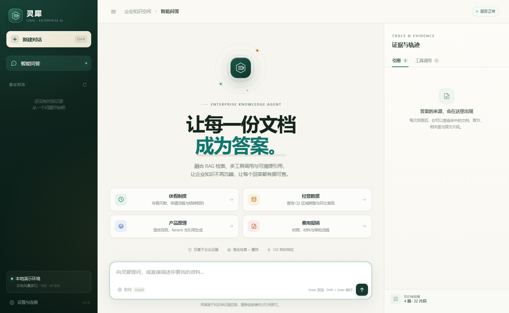
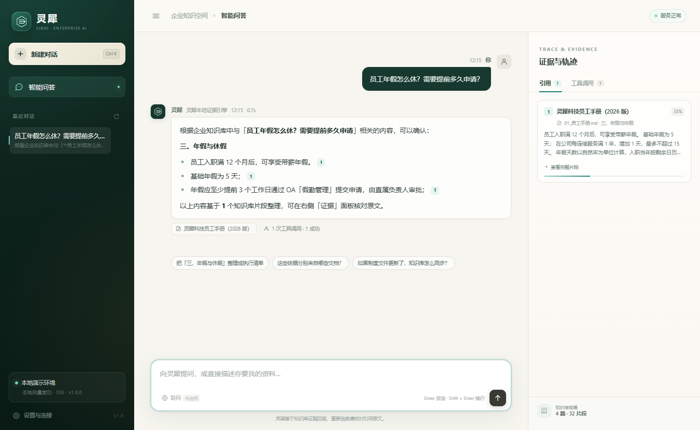
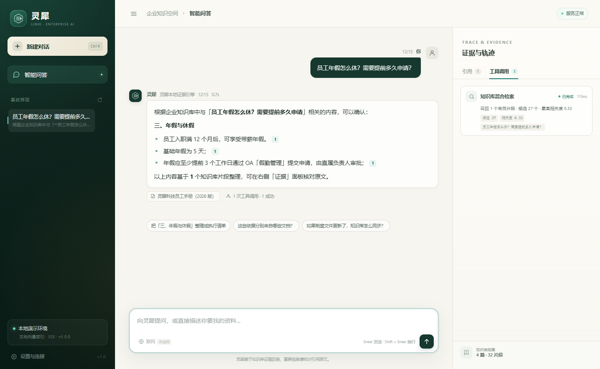
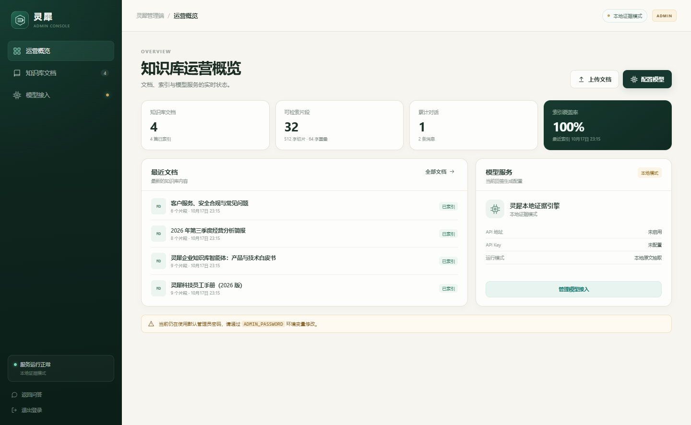
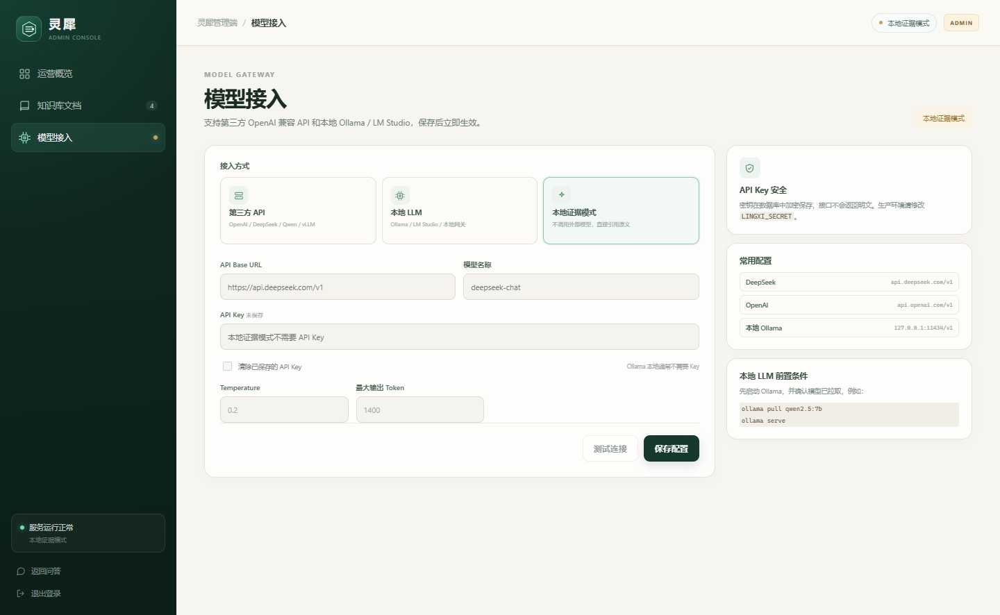
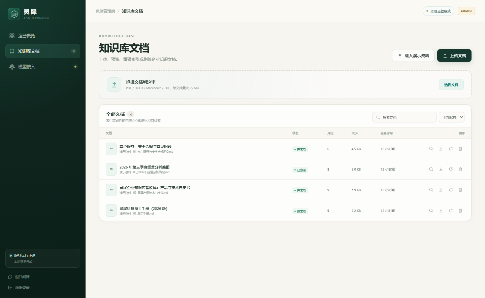

# 灵犀 · 企业知识库智能体

> 基于 **Spring Boot 3 + LangChain4j + RAG + 多工具调用** 的企业内部知识库问答系统。上传 PDF / Word / Markdown / TXT，自动切片建索引，通过混合检索、重排、Agent 工具调用与 SSE 流式输出，给出**带原文出处**的回答。

后端使用 **Java 21 + Spring Boot 3.5 + LangChain4j 1.0**。用户端只保留问答与证据查看；文档上传、切片、索引维护和模型接入都集中在独立的 **`/admin` 管理控制台**。默认使用 **H2 内嵌数据库 + 本地向量索引 + 本地证据回答引擎**，无需 MySQL、Redis、Milvus 或大模型 Key 即可完整演示。



| 对话与引用 | 证据与执行轨迹 |
| --- | --- |
|  |  |

| 管理端 · 运营概览 | 管理端 · 模型接入 |
| --- | --- |
|  |  |

| 管理端 · 知识库文档 |
| --- |
|  |

## ✨ 功能

- **管理员控制台**：独立 `/admin` 登录入口，集中管理知识库文档、索引和模型接入；用户端不再暴露上传与删除能力。
- **文档上传与知识库管理**：多文件上传、拖拽、进度反馈、状态轮询、切片预览、下载、重建索引、删除；内置 4 篇演示资料。
- **模型接入**：管理端可运行时切换第三方 OpenAI 兼容 API、本地 Ollama / LM Studio 或本地证据模式；API Key 加密保存，保存后立即生效，无需重启。
- **LangChain4j 模型网关**：使用 `OpenAiStreamingChatModel` 统一接入 OpenAI 兼容服务与本地 LLM，流式 token 直接进入现有 SSE 通道。
- **RAG 检索链路**：语义优先切分（512 字 / 64 字重叠）、Jieba 中文分词、向量召回 + BM25 召回、RRF 融合、概念锚定、多信号 Rerank、Top-5 证据。
- **可溯源回答**：关键结论带 `[n]` 引用；右侧证据面板展示文档、章节、页码、相关度、原片段。
- **Agent 多工具调用**：知识库检索、只读经营数据库查询、联网搜索（可选）；SSE 实时展示规划、工具、证据、token 与完成事件。
- **多轮会话**：会话列表、重命名、删除、历史加载；Redis 可用时会话上下文自动缓存。
- **完整中文前端**：响应式桌面/移动布局、流式对话、Markdown/表格、引用跳转、工具轨迹、反馈、设置，以及独立管理端。
- **工程化**：Spring Boot 3.5、LangChain4j、Spring Data JPA、H2 / MySQL、Redis、Milvus、管理员 Token 鉴权、API Key、限流、结构化访问日志、请求 ID、Docker Compose、Maven Wrapper、集成测试。
- **降低乱答**：高 IDF 概念锚定 + 标题优先 + 相对相关度阈值；证据不足时明确拒答，而不是让模型编造。

## 🚀 本地启动

要求 **JDK 21**，无需安装 Maven，项目已包含 Maven Wrapper。

```powershell
cd D:\项目\灵犀

# 第一次会自动构建，之后直接启动
.\run.ps1
```

如果 PowerShell 禁止运行脚本，直接双击/执行：

```bat
run.cmd
```

或者手动：

```powershell
cd D:\项目\灵犀\backend
.\mvnw.cmd -q -DskipTests package
cd ..
java -jar backend\target\lingxi-backend.jar
```

如果已经安装 Maven，也可以把 `.\mvnw.cmd` 换成 `mvn`：

```powershell
cd D:\项目\灵犀
mvn -q -DskipTests package
java -jar backend\target\lingxi-backend.jar
```

> 修改代码后需要重新打包时，直接运行 `.\rebuild.cmd` 或 `.\rebuild.ps1`。脚本会先停止正在占用 jar 的旧服务，再打包并重新启动，避免 `Unable to rename ... lingxi-backend.jar` 错误。

> IDE 提示 `程序包 org.springframework.stereotype 不存在` 时，通常是 IDE 没有把项目识别为 Maven 工程。请用 IDEA 或 VS Code 打开 **`D:\项目\灵犀` 根目录**，并按照 [`MAVEN_SETUP.md`](MAVEN_SETUP.md) 重新加载 Maven。

打开 <http://127.0.0.1:8000> 进入用户问答端。

管理端地址：

**http://127.0.0.1:8000/admin**

默认管理员密码：`lingxi-admin`。请通过 `.env` 中的 `ADMIN_PASSWORD` 修改，并同时修改 `LINGXI_SECRET`（用于加密模型 API Key）。

首次启动会自动创建 H2 数据库（`data/lingxi.mv.db`）并载入 4 篇演示资料，可直接提问或登录管理端上传自己的文档。

> 未配置 `LLM_API_KEY` 时使用「本地证据引擎」：从高相关片段中抽取关键句、按章节组织并附加引用。这是可离线验证的降级模式；配置模型后会自动切换到生成式回答。

### 推荐演示问题

1. 员工年假怎么休？需要提前多久申请？
2. 2026 年第三季度各区域销售额表现如何？
3. 灵犀的 RAG 检索链路是如何工作的？
4. 报销流程和发票要求是什么？
5. 远程办公有什么限制？
6. 企业版 SLA 是多久？

数据库类问题会同时调用 `knowledge_search` 和 `database_query`，可在右侧「工具调用」中检查参数、结果和耗时。

## 🧠 架构

```text
                       ┌──────────────────────────── 浏览器 ────────────────────────────┐
                       │  用户问答端 · 管理端 /admin · 证据面板 · 工具轨迹 · 模型配置    │
                       └───────────────┬───────────────────────────┬────────────────────┘
                                       │ POST /api/chat/stream     │ Admin API / 上传
                                       │ SSE + fetch               │ X-Admin-Token
┌──────────────────────────────────────▼───────────────────────────▼────────────────────┐
│ Spring Boot 3.5 (Java 21)                                                              │
│  ├─ 管理员 Token · API Key 鉴权 · 限流 · 结构化访问日志 · X-Request-ID                  │
│  ├─ Agent 编排：理解 → 规划 → 工具调用 → 证据核验 → 生成                               │
│  │   ├─ knowledge_search：向量 + BM25 + RRF + Rerank                                  │
│  │   ├─ database_query：受控指标解析 + 参数化只读查询                                  │
│  │   └─ web_search：Tavily / DuckDuckGo（可选）                                        │
│  ├─ RAG：512 字切片 / 64 字重叠 → 向量 → 混合召回 → 概念锚定 → 重排 Top-5             │
│  └─ LangChain4j 模型网关：第三方 API / 本地 Ollama；无模型时本地证据引擎              │
└───────────────┬──────────────────┬──────────────────┬────────────────────────────────┘
                │                  │                  │
        ┌───────▼───────┐  ┌───────▼───────┐  ┌───────▼─────────┐
        │ MySQL / H2    │  │ Redis（可选） │  │ Milvus（可选）  │
        │ 文档 & 会话   │  │ 会话上下文     │  │ 向量索引        │
        └───────────────┘  └───────────────┘  └─────────────────┘
```

### 关键设计

- **切分**：按句号、问号、换行等语义边界聚合到约 512 字，相邻片段重叠 64 字；记录章节、页码和片段序号。
- **混合检索**：Jieba 中文分词 + 字符 bigram 兜底；向量与 BM25 各取候选，RRF 融合，再结合向量分、BM25、查询覆盖率、标题匹配、短语命中重排。
- **证据门控**：从问题中抽取高 IDF 核心概念，要求引用片段命中核心概念，并优先选择章节标题命中的片段。若没有可用概念或相关度不足，明确返回「未找到依据」。
- **多轮**：短追问或含指代词时，将上一轮问题与当前问题合并检索；最近消息进入模型上下文。
- **流式**：SSE 事件拆分为 `meta / status / tool / citations / token / done / error`，前端逐步渲染工具与引用，而不是等待整段 JSON。
- **数据库安全**：不执行模型生成的任意 SQL；工具只解析区域、季度、指标等受限槽位，并生成参数化查询。
- **存储降级**：默认 H2；MySQL 通过 `DATABASE_URL` 切换；Milvus 配置不可用时自动回退本地向量索引；Redis 未启用时使用数据库会话。
- **LangChain4j 边界**：模型流式调用由 LangChain4j 的 `OpenAiStreamingChatModel` 完成；工具选择、证据核验、引用编号与 SSE 事件仍由显式状态机编排，以保证每条结论都可追踪到原文。

## 🐳 Docker Compose 一键部署

完整架构包含：应用 + MySQL 8 + Redis 7 + Milvus 2.4（含 etcd、MinIO）。

```bash
cp .env.example .env
# 按需修改 .env 中的密码、LLM Key 等
docker compose up -d --build
```

访问 <http://127.0.0.1:8000>，管理端为 <http://127.0.0.1:8000/admin>。首次构建需要拉取 Maven/Milvus 等镜像，Milvus 建议预留至少 6 GB 内存。服务健康检查通过后再启动 API。

不配置 `LLM_API_KEY` 时，容器内仍会使用本地证据引擎，上传和检索能力完整可用。也可以在登录管理端后，在「模型接入」中配置第三方 API 或本地 Ollama，运行时即时生效。首次启动也可以通过环境变量初始化：

```env
LLM_BASE_URL=https://api.deepseek.com/v1
LLM_API_KEY=sk-...
LLM_MODEL=deepseek-chat
ADMIN_PASSWORD=change-me
LINGXI_SECRET=change-this-encryption-secret
```

也可接入任何兼容 OpenAI Chat Completions 协议的服务（vLLM、Ollama、内部模型网关等）。

## 🔌 主要 API

| 方法 | 路径 | 说明 |
| --- | --- | --- |
| `POST` | `/api/admin/login` | 管理员登录，返回管理 Token |
| `GET` | `/api/admin/me` | 校验管理 Token |
| `POST` | `/api/admin/logout` | 退出管理端 |
| `GET` / `PUT` | `/api/admin/model` | 读取 / 保存模型接入配置 |
| `POST` | `/api/admin/model/test` | 测试模型 API 连通性 |
| `GET` | `/api/admin/overview` | 管理端概览与默认密码提醒 |
| `GET` | `/api/health` | 数据库 / Redis / 向量库 / 模型状态 |
| `GET` | `/api/info` | 当前模式、工具、分片与限流配置 |
| `GET` | `/api/stats` | 文档、片段、会话统计 |
| `POST` | `/api/chat/stream` | SSE 流式问答 |
| `POST` | `/api/chat` | 非流式问答（集成/测试用） |
| `GET` | `/api/documents` | 文档列表（管理员） |
| `POST` | `/api/documents/upload` | 多文件上传（管理员，字段 `files`） |
| `POST` | `/api/documents/{id}/reindex` | 重建索引（管理员） |
| `GET` | `/api/documents/{id}/chunks` | 查看切片（管理员） |
| `GET` | `/api/documents/{id}/download` | 下载原文（管理员） |
| `DELETE` | `/api/documents/{id}` | 删除文档与索引（管理员） |
| `POST` | `/api/documents/seed` | 载入演示资料（管理员，`?force=true` 重建） |
| `GET` | `/api/sessions` | 会话列表 |
| `GET` | `/api/sessions/{id}` | 会话详情与消息 |
| `PATCH` | `/api/sessions/{id}` | 重命名 |
| `DELETE` | `/api/sessions/{id}` | 删除会话 |
| `POST` | `/api/feedback` | 回答反馈 |

- 管理接口需要请求头 `X-Admin-Token`，通过 `/api/admin/login` 获取。
- 文档接口全部要求管理员 Token；用户端不再暴露上传与管理能力。
- 如启用 `LINGXI_API_KEY`，普通 `/api` 接口还需要 `X-API-Key` 或 Bearer Token；管理端接口由管理员 Token 单独保护。

## ⚙️ 配置

完整配置见 [`.env.example`](.env.example)。Spring Boot 会从项目根目录自动导入 `.env`（`spring.config.import`），也可以直接使用环境变量。常用项：

| 变量 | 默认值 | 说明 |
| --- | --- | --- |
| `PORT` | `8000` | HTTP 端口 |
| `LINGXI_API_KEY` | 空 | 为空时不启用普通 API 鉴权 |
| `ADMIN_PASSWORD` | `lingxi-admin` | 管理端登录密码，生产环境必须修改 |
| `ADMIN_TOKEN_TTL_SECONDS` | `28800` | 管理 Token 有效期 |
| `LINGXI_SECRET` | 本地默认值 | 模型 API Key 加密密钥，生产环境必须修改 |
| `LLM_BASE_URL` / `LLM_API_KEY` / `LLM_MODEL` | DeepSeek 兼容地址 / 空 / `deepseek-chat` | 首次启动的模型初始配置；之后以管理端保存的配置为准 |
| `DATABASE_URL` | H2 文件库 | MySQL 示例：`jdbc:mysql://localhost:3306/lingxi?...` |
| `DATABASE_USERNAME` / `DATABASE_PASSWORD` | `sa` / 空 | H2 默认；MySQL 时修改 |
| `REDIS_ENABLED` | `false` | 开启后会话上下文缓存到 Redis |
| `MILVUS_URI` | 空 | 例如 `http://127.0.0.1:19530`，连接失败自动回退本地索引 |
| `CHUNK_SIZE` / `CHUNK_OVERLAP` | `512` / `64` | 切片大小与重叠 |
| `RETRIEVAL_TOP_K` | `5` | 最终引用片段数 |
| `ENABLE_WEB_SEARCH` | `false` | 是否暴露联网工具 |
| `ENABLE_DEMO_SEED` | `true` | 首次启动是否载入演示资料 |
| `MAX_UPLOAD_MB` | `25` | 单文件大小上限 |
| `CHAT_RATE_LIMIT_PER_MINUTE` | `20` | 每客户端聊天请求限额 |

## 🧪 测试

```powershell
cd D:\项目\灵犀
mvn test
```

也可以使用项目自带的 Maven Wrapper：

```powershell
.\mvnw.cmd test
```

测试使用独立的内存 H2 数据库，覆盖健康检查、种子知识库、RAG 问答、数据库工具、SSE 事件流、管理员鉴权、模型配置保存/脱敏、文件上传/索引/删除。

当前测试结果：**7 tests, 0 failures, 0 errors**。

## 📁 目录

```text
灵犀/
├─ pom.xml                 # 根级 Maven 聚合工程（IDE 请打开此目录）
├─ backend/
│  ├─ pom.xml
│  ├─ mvnw / mvnw.cmd / .mvn
│  └─ src/
│     ├─ main/java/com/lingxi/
│     │  ├─ config/       # 配置、异步线程池、种子数据、向量库装配
│     │  ├─ dto/          # API 数据模型
│     │  ├─ model/        # JPA 实体（文档、会话、模型配置）
│     │  ├─ rag/          # 分词、切片、文档解析、嵌入、混合检索
│     │  ├─ repository/   # Spring Data JPA
│     │  ├─ security/     # 管理员 Token、API Key、限流、日志、安全头
│     │  ├─ service/      # Agent、知识库、会话、模型配置、工具
│     │  └─ web/          # REST + SSE + 管理端 Controller
│     └─ test/            # Spring Boot 集成测试
├─ web/
│  ├─ index.html          # 用户问答端
│  ├─ admin/              # 管理员控制台
│  └─ assets/             # 前端样式与脚本
├─ samples/               # 内置演示资料
├─ docs/                  # 界面截图
├─ MAVEN_SETUP.md         # Maven / IDE 配置说明
├─ run.ps1 / run.cmd      # Windows 一键启动
├─ rebuild.ps1 / rebuild.cmd  # 停止服务 → 重新打包 → 启动
├─ Dockerfile
├─ docker-compose.yml
└─ .env.example
```

前端使用原生 HTML/CSS/JavaScript，由 Spring Boot 直接托管，不需要单独启动前端服务。

## 🔒 安全与边界

- 文档管理接口全部要求管理员 Token；用户端不提供上传、重建索引或删除入口。
- 管理员密码只在登录时校验，登录后使用短期随机 Token；错误响应带 `WWW-Authenticate`。
- 模型 API Key 使用 AES-GCM 加密后存入数据库，管理接口只返回掩码，不回传明文。
- 上传文件大小、扩展名、数量均校验；内容哈希去重；文件名不参与磁盘路径拼接。
- 数据库工具不接受任意 SQL，所有查询参数化，仅访问受控的只读业务表。
- 检索结果在送入模型前被明确标记为证据；系统提示词要求拒绝无依据回答。
- Markdown 渲染会先转义 HTML，仅允许 `http/https` 链接；前端不执行回答中的脚本。
- 访问日志为结构化 JSON，带请求 ID、耗时、状态码；不记录文档正文。
- 生产部署请务必修改 `ADMIN_PASSWORD`、`LINGXI_SECRET`、MySQL / MinIO 密码，并配置 HTTPS。

## 📝 说明

- 本地默认使用哈希 N-gram 嵌入，以保证完全离线可运行；生产环境建议替换为 BGE-M3、text-embedding-3 等嵌入模型，并调整 `EMBEDDING_DIM`。
- 第三方模型和本地 Ollama 使用同一套 OpenAI Chat Completions 兼容协议；在管理端「模型接入」保存后立即生效。
- 后端是 Java 21，因此接入的是 **LangChain4j**，不是 Python 版 LangChain。模型流式调用已使用 LangChain4j，Agent 工具编排与证据核验仍保留显式状态机，以支持可追踪引用和细粒度 SSE 事件。
- 管理员默认密码为 `lingxi-admin`，登录后管理端会显示安全提醒；生产环境必须修改。
- Milvus 连接失败时会自动回退到本地向量索引；Docker Compose 配置已提供完整依赖链路，但本机开发环境未安装 Docker，因此未执行容器级联调。
- 经营数据库中的销售数据为演示数据，仅用于展示工具调用与数据溯源，不代表真实业务。
